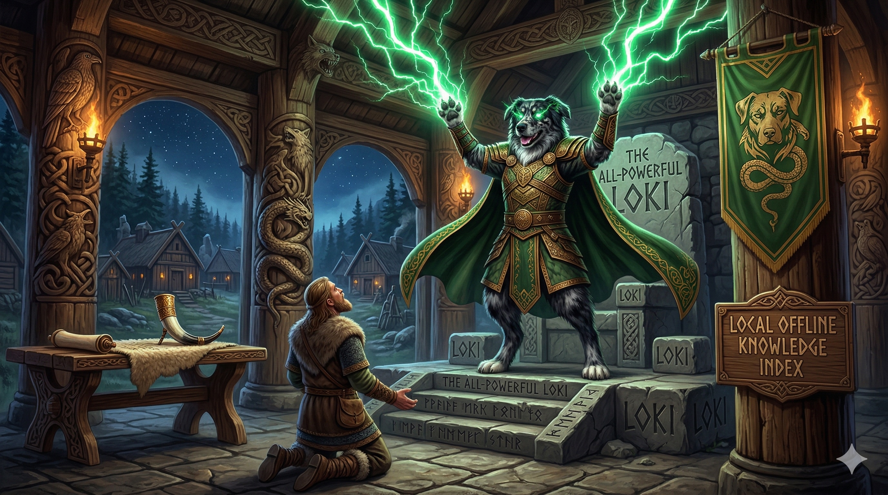

# `loki`: local offline knowledge index

`loki` is a self-hosted AI stack that gives you a private, fully offline knowledge base powered by a local LLM. It combines [llama.cpp](https://github.com/ggml-org/llama.cpp)'s `llama-server` (local inference), [Open WebUI](https://openwebui.com) (chat interface), and [Kiwix](https://kiwix.org) (offline Wikipedia and other knowledge archives), all orchestrated with Docker Compose and managed through a single CLI. An optional second engine, [Strata](https://github.com/Niko1221/Strata), serves Qwen3.8-Flash-Next behind the same API, and an optional [stable-diffusion.cpp](https://github.com/leejet/stable-diffusion.cpp) engine generates images.

Whether you're working air-gapped, want to keep queries off the cloud, or just want an always-available research assistant, `loki` runs entirely on your own hardware with no external dependencies at runtime.

> **Linux only.** `loki` targets Linux systems with systemd. `loki setup` installs and configures all prerequisites automatically.

> **AMD GPUs only.** `llama-server` is built against ROCm for one AMD GPU architecture. Install the `amdgpu` kernel driver yourself, ideally _before_ installing `loki`; the container bundles the ROCm user-space libraries it needs.

## Prerequisites

- A Linux system with systemd and an AMD GPU (`/dev/kfd` and `/dev/dri` present)
- [`pipx`](https://pipx.pypa.io/stable/installation/)
- `curl`

`loki setup` installs everything else (Docker, aria2, avahi-daemon).

## Installation

Clone the repository and install the CLI:

```bash
git clone https://github.com/smcolby/loki.git
cd loki
pipx install -e .
```

## Configuration

Open `config.yaml` and adjust the settings before running `loki setup`:

```yaml
url: loki.local              # Hostname used to reach the server on your local network.

ports:
  caddy: 80      # Caddy reverse proxy (Open WebUI).
  kiwix: 8080    # Kiwix offline knowledge server.
  api: 8090      # Model API for every engine (OpenAI and Anthropic compatible).

llama:
  models_dir: ~/.llms                               # One subdirectory per model.
  ref: 23deec025587a58469bdf0120313ff88a1ddcc7b     # llama.cpp commit to build.
  gpu_targets: gfx1100                              # AMD GPU architecture (rocminfo | grep gfx).
  rocm_version: 7.2.4                               # ROCm toolchain and bundled runtime.
  max_loaded: 1                                     # Models kept in VRAM at once.
  defaults:                                         # Options every model gets.
    n-gpu-layers: 99
    flash-attn: "on"

strata:
  engines: {}                                       # Engine name -> config file (see below).
  data_dir: ~/.llms/strata                          # Holds the engine configs and model files.
  ref: c6f6427d9de9016fd92d13e29740f65625261df7     # Strata commit to build.
  gpu_targets: gfx1100
  rocm_version: 7.10.0a20251120                     # TheRock ROCm wheels.

image:
  engines: {}                                       # Engine name -> model id and sd-server args.
  models_dir: ~/.llms                               # Mounted read-only into every image engine.
  ref: 3f8527a46c54ecf4cb4ed6003da8e8982283c73c     # stable-diffusion.cpp commit to build.
  gpu_targets: gfx1100
  rocm_version: 7.2.4

kiwix_files:
  - name: wikipedia_en_all_nopic
    url: https://download.kiwix.org/zim/wikipedia/wikipedia_en_all_nopic_2025-12.zim
```

`loki/config.default.yaml` lists the full default `llama.defaults` block. Keys under `defaults` are `llama-server` long option names without the leading dashes. Quote `"on"` and `"off"` so YAML keeps them as strings.

Edit `kiwix_files` (datasets [here](https://download.kiwix.org/zim/)) to match what you want downloaded. `loki` generates the `Caddyfile`, `.env`, `models.ini`, and `compose.engines.yaml`; do not edit those files by hand.

## Adding models

`loki` serves hand-curated GGUF files; it never downloads models. Each subdirectory of `llama.models_dir` that contains a `preset.ini` becomes one or more models. A section header names the model id clients request, and its options are `llama-server` long option names:

```ini
; ~/.llms/gemma4-31b-iq4xs/preset.ini
[gemma4-31b-iq4xs]
model = gemma-4-31B-it-IQ4_XS.gguf
model-draft = mtp-gemma-4-31B-it-Q8_0.gguf
spec-type = draft-mtp
ctx-size = 163840
temp = 1.0
```

Relative `model`, `model-draft`, `mmproj`, and `chat-template-file` paths resolve against the preset's directory, and each file must exist. A preset may declare several sections (for example the same GGUF at two context sizes), but a model id may appear only once across all presets. Global settings belong in `llama.defaults`, so a `[*]` section in a preset is an error.

`loki start` assembles every preset into `models.ini` and lists the model ids it found. Restart the stack (`loki stop && loki start`) after adding or editing a preset.

`llama-server` loads a model on its first request and unloads the least recently used one when more than `max_loaded` would be resident. With `fit: "off"`, a preset whose context does not fit in VRAM fails to load with an error instead of silently shrinking.

### Adding Strata

Strata streams a mixture-of-experts model's experts from host memory, so it runs Qwen3.8-Flash-Next and its fine-tunes on a GPU too small to hold them. Each entry under `strata.engines` maps an engine name to an engine config file in `strata.data_dir`:

```yaml
strata:
  engines:
    qwen: qwen.json
    swift: swift.json
```

Each engine runs in its own container as Compose service `strata-<name>`, defined in the generated `compose.engines.yaml`. Engine names use lowercase letters, digits, `_`, and `-`. A config file looks like this:

```json
{
  "args": ["--pack", "/home/you/.llms/strata/packs/iq2_xs", "--native", "/home/you/.llms/strata/models/model-00001-of-00002.gguf", "--max-context", "131072"],
  "tokenizer": "/home/you/.llms/strata/packs/iq2_xs/tokenizer",
  "model_name": "qwen3.8-flash-next-iq2_xs",
  "env": {"STRATA_RESIDENT_PIN": "0"}
}
```

`args` are Strata engine arguments, `model_name` is the model id clients request, and `env` (optional) sets engine environment variables. Use absolute paths inside `data_dir`, which is mounted read-only at the same path. The image supplies the engine binary, its libraries, and a hipBLASLt tuning table for `gpu_targets`, so an engine config must not set `exe`, `cwd`, `lib_dirs`, `backend`, or `log`. `loki start` stops with an error if a listed engine config is missing. All engines share one image, and an engine that is not loaded holds no GPU memory and little host RAM.

On gfx1100 (RX 7900 XT and XTX), Strata 0.2.19 turns on by default the prompt and decode switches that earlier configs listed by hand: the fused int8 prompt experts, prompt attention and GEMMs on the matrix cores, the matrix-core block scorer for long prompts, and the exact decode fusions (`STRATA_GFX11_DEFAULTS=0` turns them all off, and a switch given in `env` always wins). The Swift config therefore lists only what the defaults leave out: `--prefill auto:32768`, which reads long prompts in chunks of up to 32,768 tokens; `STRATA_PF_SWITCH_MIN_T=4096` and `STRATA_PF_HCDOWN=1` for the prompt path; `STRATA_RESIDENT_PIN=1`; `GPU_MAX_HW_QUEUES=2`, which puts the draft head's stream on the same hardware queue as the verify stream; and `--vram-reserve-mib 832`, without which Strata warns on each request that the card is nearly full and the driver may page GPU memory to system RAM. On an RX 7900 XTX with Swift IQ3_XXS at 262K context, against Strata 0.1.43.1 with the earlier hand-listed switches, prompt reading rises from 2,630 to 3,460 tok/s at 32K tokens, from 3,000 to 3,700 tok/s at 86K, and from 2,420 to 3,350 tok/s at 206K; decode rises from 90 to 103 tok/s on a short prompt, from 85 to 97 tok/s after 86K, and from 71 to 82 tok/s after 206K.

The defaults round differently from 0.1.43.1, so greedy answers change slightly, but they predict text no worse. Over about 20,000 teacher-forced tokens (a passage copied from the document and a fresh passage, each after documents of 5K to 107K tokens), the mean loss per token differs from 0.1.43.1 by at most 0.013 nats, and no difference is statistically significant; 148 of the first 150 GSM8K test problems are solved by 0.1.43.1 and by 0.2.19, with the same two misses; and facts planted at 10%, 50%, and 90% depth of 86K- and 206K-token prompts are found in all 18 cases. The config turns off `STRATA_HC_Q8`: the 8-bit hyper-connection weights that 0.2.19 also turns on by default raised the per-token loss on copied passages by 0.014 nats (95% interval 0.004 to 0.025) in two independent groups of probes, and added only 1% to 5% to decode (medians over 8 starts with them and 4 without). Strata leaves the hipBLASLt tuning table off on gfx1100 because it changes rounding; this image uses it anyway, since it reads prompts 5% to 8% faster with no measurable change in the per-token loss.

Measured and left out on this card: the DFlash2 drafter (decode within run-to-run variation of the MTP drafter, prompts read 13% to 18% slower), `STRATA_SCORES_THREAD=1` (no change at 206K tokens once the matrix-core block scorer is on), `--spec 5` with `--spec-min-p 0.7`, and `--lookup-chain 2` (each within 3% of the defaults). `STRATA_SH_STREAM=1` stays off: the shared expert on a separate stream costs this card 5% to 8% of decode.

Only one engine holds the GPU at a time. The first request for a model on the other engine waits for in-flight requests to finish, unloads the current engine's models, and then loads the requested one.

Strata's web dashboard (a live monitor of the model, GPU, CPU, and RAM, plus its settings) is at `http://loki.local/strata/`. Each Strata engine runs its own dashboard, so the gateway shows the one holding the GPU, or the most recently used one while an image or llama model holds it. It opens on the Monitor tab, hides the Chat tab, and is read-only: its chat would bypass the gateway's GPU arbitration and its settings form would change the engine, so the gateway refuses anything but `GET`.

To have a model ready for the first prompt, name it under `preload` at the top level of `config.yaml`:

```yaml
preload: swift-qwen3.8-flash-next-iq2_xs
```

The gateway loads it in the background whenever it starts (`loki start`, `loki kill`, or a reboot), unless a request has already claimed the GPU. It stays loaded until a request for a model on another engine swaps it out. `loki status` shows it as `loaded` once it is ready. Only text models can be preloaded.

### Adding image generation

An image engine runs stable-diffusion.cpp's `sd-server` for one image model. Each entry under `image.engines` names the engine, the model id clients request, and the `sd-server` arguments:

```yaml
image:
  engines:
    qwen:
      model: qwen-image-2.1-q8_0
      args:
        - --diffusion-model
        - /home/you/.llms/qwen-image-2.1/qwen-image-2.1-Q8_0.gguf
        - --llm
        - /home/you/.llms/qwen-image-2.1/Qwen3-VL-8B-Instruct-UD-Q4_K_XL.gguf
        - --llm_vision
        - /home/you/.llms/qwen-image-2.1/Qwen3-VL-8B-Instruct-mmproj-F16.gguf
        - --vae
        - /home/you/.llms/qwen-image-2.1/qwen_image_2.1_vae_bf16.safetensors
        - --params-backend
        - disk
        - --strength
        - "1.0"
        - --ref-image-args
        - vae_input_max_pixels=1048576
        - --seed
        - "-1"
        - --width
        - "1920"
        - --height
        - "1280"
```

`--width` and `--height` set the size of a request that names none; both must be multiples of 32. `--llm_vision`, `--strength`, and `--ref-image-args` matter only for edits (below). `--seed -1` picks a new random seed for every request. sd-server's default is the fixed seed 42, and Open WebUI never sends one, so every image would start from the same noise; an edit of a generated image then starts from the noise that made it, and the result comes out over-sharpened and over-contrasted. Each engine runs as Compose service `image-<name>` (container `loki-image-<name>`) in `compose.engines.yaml`, with `models_dir` mounted read-only at the same path, so use absolute paths inside it. Model ids use letters, digits, `.`, `_`, `:`, `/`, and `-`. All image engines share one image. sd-server keeps about 1.6 GiB of GPU memory after a generation, so a supervisor in the image starts it on the first request and stops it when another engine needs the GPU; the arguments must not set `--listen-ip` or `--listen-port`.

A few-step checkpoint such as Qwen Image 2.1 Turbo runs on its own sigma schedule rather than one of sd-server's schedulers. Give its engine the same files with its own `--diffusion-model`, `--steps 8`, and `--sigmas 1.0,0.978453,0.95418,0.926626,0.89508,0.845148,0.704534,0.414568,0.0` (the checkpoint's eight sigmas plus the final 0). sd-server then runs one step per sigma for every request, whatever step count the request asks for. Leave `--cache-mode easycache` off for it: on Turbo, EasyCache skips 2 of the 8 steps and leaves visible grain and smeared detail (on the 40-step base model it skips 24 to 26 steps).

Image models answer `POST /v1/images/generations` and `POST /v1/images/edits` on the model API and stay out of `/v1/models`, which chat clients read as their model list. A chat request for an image model, or an image request for a chat model, fails with HTTP 400. An image request takes the GPU like any other engine swap: it waits for in-flight text requests, unloads the text engines, and then generates. The next chat request stops sd-server and reloads its model.

To generate images from Open WebUI, open **Admin Panel > Settings > Images**, choose the OpenAI engine, set the base URL to `http://gateway:8080/v1`, enter any API key, set the model to the image model id, and set the image size (Open WebUI always sends one, so the engine's default applies only to other clients).

Edits take reference images: `/v1/images/edits` is OpenAI's multipart form, with the images as `image[]` parts, and Qwen Image 2.1 accepts up to 10. Qwen Image reads them through its Qwen3-VL text encoder's vision weights, so the engine needs `--llm_vision` pointing at the matching `mmproj` file (Unsloth's `Qwen3-VL-8B-Instruct-GGUF` ships one); without it sd-server rejects every edit. `--strength 1.0` starts an edit from noise, as Qwen's own pipeline does: sd-server's default of 0.75 starts from the first image, so the result keeps its colors and lighting and largely ignores the instruction. Plain generations have no starting image, so `--strength` does not affect them. sd-server resizes every reference to one pixel area before encoding it; for Qwen Image 2.1 that area defaults to the output's, so each reference costs as many tokens as the image being generated, and the cache of them outgrows the GPU past two references. `vae_input_max_pixels=1048576` sets that area to 1 megapixel instead, which lets four references fit on a 24 GB card. To edit from Open WebUI, enable **Image Editing** in the same settings page with the same engine, base URL, key, and model, and set an edit size: without one the output takes the first image's size, which for a phone photo is slow and too large to decode untiled. Attach images to a chat message with image generation on, and Open WebUI sends the images from the last two messages that have any.

### Image Studio

[`tools/image_studio.py`](tools/image_studio.py) is an Open WebUI function that adds six image models. Each sends your message and images unchanged to an image engine, with no chat model rewriting the prompt or answering afterward:

| Model | Size | Images it sends |
| --- | --- | --- |
| Image Studio: Draft | 1248x832, 40 steps | the images attached to your message, if any |
| Image Studio: Production | 1920x1280, 40 steps | the images attached to your message, if any |
| Image Studio: Refine | the edited image's size, up to 1920x1280 | the most recent earlier image in the chat, then any images attached to your message |
| Image Studio: Turbo Draft, Turbo Production, Turbo Refine | as above, 8 steps | as above |

Draft, Production, and Refine use Qwen Image 2.1 (`qwen-image-2.1-q8_0`); the Turbo models use Qwen Image 2.1 Turbo (`qwen-image-2.1-turbo-q8_0`), which needs its own image engine (above). Draft is a quick preview of a Production image at the same step count, though a different size lays the scene out differently. Use Refine to change a result: describe only the change, and it edits the latest image without the original references. To install it, open **Admin Panel > Functions**, click **+**, paste the file, set the ID to `image_studio`, save, and enable it. Then enable **Vision** for each Image Studio model under **Admin Panel > Settings > Models**, so Open WebUI accepts attached images. It needs a saved chat (temporary chats are not supported).

## Setup

Run once after configuring:

```bash
loki setup
```

This will:

1. **Display `config.yaml`** and ask you to confirm before proceeding.
2. **Install system packages** (aria2, avahi-daemon, avahi-utils) via `apt-get` or `dnf`.
3. **Install Docker** via the official convenience script and add your user to the `docker` group.
4. **Check for AMD GPU devices** (`/dev/kfd` and `/dev/dri`) and warn if the `amdgpu` driver is missing.
5. **Add `LOKI_ROOT` to your shell profile** so `loki` commands work from any directory.
6. **Generate the `Caddyfile`, `.env`, and `models.ini`** from your configuration and model presets.
7. **Build missing local images**: the API gateway, `llama-server` (10 to 20 minutes), and the Strata and image engines when any is configured.
8. **Download ZIM files** listed in `kiwix_files` using aria2.

Steps that change your system prompt `[Y/n]`. Skipped steps must be completed manually before the stack will function correctly; `loki start` builds any image step 7 skipped.

## Usage

```
loki start    Write generated files, start the Docker Compose stack, and broadcast hostname via mDNS.
loki stop     Stop the Docker Compose stack and terminate the mDNS broadcast.
loki status   Check the health of running services and list model load states.
loki kill     Cancel in-flight requests by restarting Open WebUI, the gateway, and every engine.
loki update   Upgrade system packages, pull Docker images, and build missing local images.
loki cleanup  Remove ZIM files and local images no longer matching config.
```

After `loki start`, Open WebUI is available at `http://loki.local` (or whichever `url` you configured).

Use `loki kill` when a request hangs, such as an image generation that Open WebUI's stop button leaves running: sd-server cannot abort a generation, so restarting the services is the only way to free the GPU. Chats and settings persist, Caddy and Kiwix keep running, and each model loads again on its next request (the `preload` model loads right away).

Local image tags name every build input: `loki-llama:<gpu_targets>-rocm<rocm_version>-<ref>`, `loki-strata:<gpu_targets>-rocm<rocm_version>-<ref>`, `loki-image:<gpu_targets>-rocm<rocm_version>-<ref>`, and `loki-gateway:<hash of the gateway sources>`. `loki update` builds only images whose tag is missing, so an unchanged config rebuilds nothing. To pick up a new llama.cpp release, set `llama.ref` to the new commit and run `loki update`. `loki cleanup` then offers to remove the image built for the previous commit.

## Connecting other clients

A gateway listens on the LAN at `http://loki.local:8090` without an API key and routes each request to the engine serving the requested model. It exposes:

- An OpenAI-compatible API at `/v1` (`/v1/chat/completions`, `/v1/models`). `/v1/models` lists every engine's models, with the engine in `owned_by`. A model stays listed while its engine loads it or restarts, since Strata reports no models during a load. Clients that require a key accept any placeholder value.
- An Anthropic-compatible `/v1/messages` endpoint, so Claude Code can use it by setting `ANTHROPIC_BASE_URL=http://loki.local:8090`.
- `/health`, which reports each engine's state and which one holds the GPU.

Request reasoning depth with the OpenAI `reasoning_effort` field. A chat template may reject effort levels its model does not support; the request then fails with an error rather than running at a different level.

## Connecting Kiwix to Open WebUI

A ready-made Open WebUI tool definition lives at [`tools/kiwix_tool.py`](tools/kiwix_tool.py). It gives the model two functions, `search_article_titles` and `read_articles`, which reach the Kiwix server over the Docker network at `http://kiwix-serve:8080`, so it works regardless of your configured host port. Articles come back as plain text with headings, without citation markers, reference lists, or navigation boxes, and up to 30,000 characters each.

To load it:

1. Open `http://loki.local` and navigate to **Workspace → Tools**, then click **+**.
2. Paste the full contents of `tools/kiwix_tool.py` into the editor and save.
3. Enable the tool for each model: **Workspace → Models** (or **Admin Panel → Settings → Models**), edit the model, and check the tool under **Tools**. A tool that is installed but not enabled on a model is never offered to it.

Open WebUI calls tools natively by default (**Advanced Params → Function Calling**), which every model loki serves supports. To update the tool later, paste the new file over the old one in the same editor.

If web search is also enabled, the model may search the web instead of Kiwix; ask for "the offline Wikipedia" or disable web search in that chat to steer it.

## Reading replies aloud

Open WebUI's read-aloud button uses the browser's built-in voices unless it is given a speech server. loki can run [Kokoro-FastAPI](https://github.com/remsky/Kokoro-FastAPI), which serves the 82M-parameter Kokoro voice model through OpenAI's `/v1/audio/speech` API. It runs on the CPU only, so playing a reply never unloads the chat model or waits for an image. Enable it in `config.yaml`:

```yaml
tts:
  enabled: true
  voice: af_heart    # Voice used when a request names none
```

`loki start` then runs it as Compose service `kokoro` (container `loki-kokoro`), reachable only inside the stack. To use it, open **Admin Panel > Settings > Audio**, set the text-to-speech engine to OpenAI, the base URL to `http://kokoro:8880/v1`, any API key, the model to `kokoro`, and the voice to a Kokoro voice name. Kokoro lists its voices at `/v1/audio/voices`. The first letter of a name is its accent (`a` American, `b` British), and the second is `f` or `m`. Set **Response splitting** to **Paragraphs** so headings and list items are read as separate clips with a short gap between them; the default **Punctuation** joins any piece under 50 characters to the next, so a heading runs straight into its first sentence. Each user can pick a different voice under **Settings > Audio**. To change the speaking rate for everyone, set the text-to-speech **Parameters** field in the same admin page to `{"speed": 1.2}` (Kokoro accepts 0.25 to 4.0). Open WebUI caches each spoken sentence without the rate in its key, so clear `data/open-webui/cache/audio/speech` afterward to avoid replaying sentences at the old rate. On a 16-core CPU, Kokoro speaks about five times faster than real time and uses about 1.2 GiB of RAM.

## Cloning voices with Breeze

[Breeze TTS 2](https://huggingface.co/BreezeBlue/Breeze-TTS-2) is a 3B-parameter speech model. It clones a voice from a short recording, invents one from a description, and follows instructions such as "speak slowly with a restrained tone". It speaks English and Chinese. Its weights and everything it generates are licensed for research and non-commercial use only (its code is Apache-2.0), so use it for personal projects.

Download the checkpoint (about 7.7 GB, every file in the Hugging Face repository except `assets/`) into `~/.llms/breeze/model`, then enable the engine in `config.yaml`:

```yaml
speech:
  enabled: true
  data_dir: ~/.llms/breeze   # model/ (the checkpoint), library/ (voices and audio), cache/
```

`loki start` builds the `speech-breeze` image (about 30 GB, mostly the ROCm PyTorch base) and serves the Studio at `http://loki.local/breeze/`.

Breeze shares the GPU like every other engine. Generating speech unloads the loaded model and starts Breeze, which needs about 45 s once its compile cache is warm and about 95 s the first time. The next chat or API request unloads Breeze and loads that model again. The Studio page, the voice library, and saved audio stay available while another model is loaded, and Breeze uses about 10 GiB of VRAM while it runs.

On an RX 7900 XTX, Breeze speaks at about 0.75x real time (one second of speech needs about 1.3 s, with `--fast-depth-decoder`, which roughly doubles the speed of plain eager mode; Breeze's other fast stages add no speed here and need about 10 GiB more VRAM). The Studio therefore starts playback only when the rest of the audio will be ready by the time the first part finishes playing, and shows a progress bar and a countdown. Text of any length (up to 60,000 characters) is split at sentence ends into chunks of at most 500 characters, spoken in order with short pauses, and saved as one file.

In the Studio:

- **Generate** accepts text, an optional saved voice, an optional instruction, its strength (1 to 6; a value above 1 needs an instruction), and a seed. Without a saved voice, Breeze invents a different voice for each chunk, so choose or save a voice before narrating long text.
- **Voices** saves a voice from a clean recording of 3 to 30 seconds and its exact transcript, including repeated words. Any audio file the browser can play works; the page converts it to 24 kHz mono before uploading. After generating a short sample (about two sentences) from an instruction, **Save voice** stores the sample as a voice, which makes the designed voice identical across later requests.
- **Narrate** turns long text (a paper or a book, up to 2,000,000 characters and 500 chapters) into one audio file per chapter. Start each chapter with a line such as `# Chapter title` (one or two # signs). Text before the first heading becomes a separate chapter, and each heading is read aloud before its chapter unless you untick the option. After you press **Create and start** the job runs in the supervisor, so closing the page does not stop it. The page lists progress, the time left, and download links for each chapter as it finishes, and the chapters also appear in the Library, titled `<job title> - 01 <chapter title>`. **Stop** pauses a job, and **Resume** continues from the last saved part, including after a restart or a crash.
- **Library** lists saved audio with its settings, and downloads it as WAV (the master), M4A (AAC at 128 kbps), or MP3 (128 kbps). The M4A and MP3 copies are leveled to -20 dB RMS with peaks under -3 dB, the limits ACX publishes for audiobooks, at 44.1 kHz with title tags.

A narration job speaks each paragraph as one part when it has 1,200 characters or fewer, and cuts a longer paragraph at sentence ends. Blank lines separate paragraphs; text with no blank lines is read as one paragraph per line. The limit leaves room under Breeze's 120 s cap at the slowest pace measured (0.089 s per character). The job saves every part as soon as it is made and joins the parts into a chapter file when the chapter is complete. A chapter that is already finished is not generated again on resume. Each part is checked against its text: audio far shorter or longer than its text needs, silent audio, a silence over 4 s, or audio that hit Breeze's length cap is spoken again with another seed, up to three attempts. If no attempt passes, the closest one is used and the chapter lists a warning. While a job runs, Breeze occupies the GPU, so an Open WebUI or `pi` request waits 2 minutes and then fails with a 503; stop the job or wait for it to finish first. At the measured 0.77x real time, 10 hours of narration needs about 13 hours of generation; jobs of that length have not been run.

Breeze serves one request at a time. The Studio has no sign-in, like the rest of the LAN-facing stack, and refuses changes without the Studio's request header, which a page on another site cannot add. Clone only voices you have the right to use.

---

## Advanced

### Local hostname resolution

The default `url: loki.local` uses the `.local` TLD, which is broadcast via **mDNS** and resolves automatically on your LAN without any router configuration. `loki setup` installs `avahi-daemon` for this. When `loki start` runs, it spawns `avahi-publish-address` to announce the hostname for as long as the stack is running; `loki stop` terminates the announcement.

If you prefer a non-`.local` hostname (e.g. `loki.home`), set it in `config.yaml` and add a static entry to `/etc/hosts` on each client device. `loki` skips the mDNS broadcast for non-`.local` hostnames.

### `LOKI_ROOT`

By default, loki resolves all paths (`config.yaml`, `Caddyfile`, `.env`, `models.ini`, `data/kiwix/`) relative to the current working directory. Run every `loki` command from the repository root, or set `LOKI_ROOT` to point elsewhere:

```bash
export LOKI_ROOT=/path/to/loki
loki setup
```

`loki setup` offers to add this export to your shell profile automatically (step 5).

### Building for a different GPU

Set `llama.gpu_targets` (and `strata.gpu_targets`) to your GPU's architecture (`rocminfo | grep gfx`, for example `gfx1201`) and run `loki update`. Each image keeps only the ROCm BLAS kernels for that architecture, so it holds a single target.

---

## Development

```bash
python3 -m venv .venv
source .venv/bin/activate
pip install -e ".[dev]"
pre-commit install
pytest
```

Linting mirrors CI exactly; run the same checks locally with:

```bash
ruff format --check .
ruff check .
pyright
```
